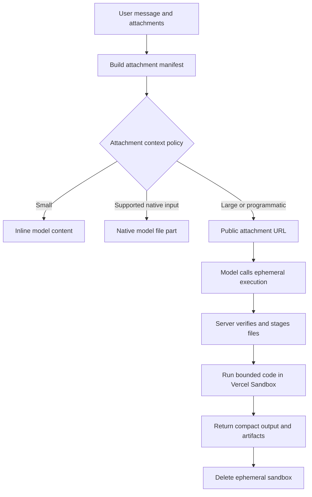

# Code Execution Architecture

## Purpose

SilkChat will use Vercel Sandbox to execute model-generated JavaScript and Python, inspect large attachments programmatically, and return compact answers or generated artifacts without placing entire source files in model context.

There are two execution environments, and the assistant picks per task. `execute_code` is always ephemeral: a fresh sandbox that is deleted after the call. `computer_run` runs on the assistant's own computer, which keeps its files between chats. See [The assistant's computer](#the-assistants-computer).

Sandbox billing uses Vercel's published Pro rates. Computer sessions reserve a bounded amount when they wake and settle to measured provider usage when they sleep.

## Product principles

1. **Do not spend context on bulk data.** Files above the context threshold are represented by a compact manifest and inspected with code.
2. **Do not make storage mechanics part of the UI.** Long pasted text and ordinary eligible attachments share one attachment area even though their model-delivery routes may differ.
3. **Do not grant persistence silently.** Setting up the computer takes one explicit Allow. After that it is the assistant's to use.
4. **Do not trust model-provided resource identifiers.** The server resolves user, thread, attachment, and sandbox ownership.
5. **Bound every resource.** Code size, dependencies, runtime, output, file transfer, concurrency, and retained state all have enforced limits.
6. **Prefer recoverable results.** Tool failures should be structured so the model can make one meaningful correction without creating loops.

## High-level flow



## Attachment context policy

Attachment presentation and model delivery are separate decisions.

### Pasted text

Text is graded by the client-side `estimateTokenCount` helper into three grades:

- Up to `PASTED_TEXT_FILE_TOKEN_THRESHOLD` (8,000): leave the paste in the composer and send it directly in model context, without a chip.
- Up to `MAX_INLINE_TEXT_ATTACHMENT_TOKENS` (32,000): create a `Pasted Text N.txt` attachment chip and upload it. The model still reads it in full, which costs less than a tool-call loop.
- Above that: the chip's content goes to the model as a scoped URL/reference that must be inspected with code execution, and code execution turns on.

Paste as text (Ctrl/⌘+Shift+V, the usual plain-text paste) keeps anything up to 32,000 tokens in the composer; above that it still becomes a chip.

Attached text files take the same grades, apart from always being chips: one above 32,000 tokens turns code execution on just as the same text pasted would.

URL references are emitted only when code execution is enabled and the selected model supports function calling. Without that route, text above 32,000 tokens is withheld with a model-visible instruction to ask the user to enable execution or select a capable model.

The upload token ceiling is separate from this context threshold. It is raised from 32,000 to 8,000,000 estimated tokens as a final abuse guard, leaving the existing 15 MB byte limit as the practical upload ceiling. A file being uploadable does not make it eligible for direct model context.

The URL-backed case renders as `Pasted Text N`. Upload progress and the backing URL are implementation details. The chip offers **Show as text**. Selecting it:

- aborts an in-flight upload when possible;
- removes the local attachment state;
- deletes an already uploaded object;
- inserts the original text at the current end of the composer draft; and
- restores focus to the textarea.

The client classification improves immediate UX, but the server remains authoritative. It must recompute the delivery class from trusted attachment metadata or content before building model messages.

### Local draft lifecycle

Composer drafts are stored in a versioned local registry keyed by thread. New chats use separate root and folder-scoped keys until their first message creates a thread. Each draft contains textarea content and uploaded attachment metadata, allowing both to survive refreshes without uploading the same object again. Draft writes are debounced and deduplicated, and uploaded paste metadata omits the original large source string to keep local persistence off the composer hot path.

Submitting clears the local draft without deleting its attachments because they have become part of the message. Deleting a thread cascades through its draft and queues any draft-only attachment objects for deletion. Deleting a folder and its threads can cascade by folder and explicit thread IDs; archiving a non-empty folder retains its drafts. Failed object deletions remain in a local retry queue and are retried when the sidebar next initializes or another cascade runs.

### Eligible regular attachments

The same long-attachment routing area will coalesce ordinary eligible uploads with pasted-text attachments. The targeted formats are:

- plain text and Markdown;
- source code and structured text such as JSON, YAML, XML, and SQL; and
- spreadsheets and tabular datasets such as CSV, TSV, XLSX, and Parquet.

Images and PDFs are explicitly excluded from this policy. Images remain on the existing vision/reference-image path. PDFs remain on the existing native-PDF path and are not converted into code-execution URLs as part of this sprint.

### Attachment manifest

Large eligible attachments should appear in model context as a small manifest containing:

- the existing public R2 asset URL;
- display filename and media type;
- byte size and estimated token count when known;
- whether native model input is available; and
- an instruction to inspect it programmatically and not print the whole file.

Do not introduce signed or presigned URLs for this flow. Tool input must never accept a Vercel sandbox name.

### Supported data formats

The first data-oriented expansion should add CSV, TSV, XLSX, Parquet, SQLite, and bounded archives. Archives require compressed-size, expanded-size, entry-count, nesting, and path-traversal protections. The existing 15 MB upload limit remains until cost and latency measurements justify a change.

## Ephemeral execution

An ephemeral call creates a sandbox with `persistent: false`, stages the selected attachments and script, executes it, captures bounded output, records usage, and permanently deletes the sandbox.

### Tool contract

`execute_code` should evolve toward:

```ts
{
    language: "javascript" | "python"
    code: string
    dependencies?: string[]
    attachmentUrls?: string[]
    timeoutMs?: number
    network?: "none" | "public"
}
```

The model receives only URLs selected from the current message/thread attachment manifest. The server rejects arbitrary local paths and URLs that are not part of that manifest. Files are staged under a generated workspace directory and a safe path map is returned to the execution wrapper.

### Network policy

Use the least-capable policy that completes the task:

1. Allow approved package registries and the attachment source during setup.
2. Stage dependencies and inputs.
3. Change the sandbox firewall before running model-generated code.
4. Default to no network for private-data analysis.
5. Retain public network access only for tasks that require live retrieval.

No SilkChat, database, model-provider, or storage credentials are placed in the sandbox environment. Long attachments use the existing public R2 asset URL; no signed-URL mechanism is added.

### Output and artifacts

Output is a combined bounded budget, collected while streaming rather than fetched fully and truncated afterward. The result includes exit status, duration, truncation status, and a small stdout/stderr payload. Scripts that produce large or binary results write artifacts; SilkChat uploads those artifacts and returns attachment handles instead of model-context bytes.

Each execution receives a unique directory through `SILKCHAT_ARTIFACT_DIR`. Files written beneath it are treated as untrusted staging output and are exported before the sandbox is stopped, deleted, suspended, or released. The computer receives a fresh directory for every call so files from an earlier execution are never republished implicitly.

The export bridge:

1. walks only that execution's output directory, with bounded depth and entry count;
2. rejects links, non-regular files, unsupported formats, invalid signatures, and files outside the size budgets;
3. uploads accepted bytes to the dedicated `code-artifacts/{userId}/` R2 namespace;
4. returns compact artifact metadata and a direct public R2 URL to the model rather than file bytes; and
5. projects that metadata into ordinary assistant `file` parts for durable download and message replay.

The initial limits are five files per execution, 15 MB per file, and 25 MB total. Supported outputs are PDF, CSV/TSV, JSON and text formats, XLSX/DOCX/PPTX, ZIP, SQLite, Parquet, PNG, JPEG, and WebP. Active document formats such as HTML and SVG are not exported. No signed URL mechanism is introduced.

The assistant should normally refer to the automatically attached file by filename. If it emits a Markdown link, it must use the returned HTTPS URL exactly. Sandbox-local and `file:` URLs are never user-facing and remain blocked by the Markdown renderer.

Before deletion, stop the sandbox and record active CPU, per-session provisioned memory duration, ingress, egress, snapshot byte-duration, session count, runtime, VCPU count, and creation outcome. Convert those provider metrics to microdollars before deleting the sandbox and settling its usage reservation.

### Billing policy

Ephemeral calls reserve the bounded per-call tool estimate before execution, and that provisional event is reconciled immediately after the VM stops using the measured-cost calculator. If final metrics cannot be retrieved, the conservative reserved amount is settled rather than silently releasing consumed infrastructure usage.

## The assistant's computer

Each account gets one computer, and it belongs to the assistant. The prompt and tool descriptions say "your computer" on purpose: framed as the user's property, a model treats it as off limits and asks permission for ordinary work. The display name defaults to "Silky's computer" and users can rename it.

Owned by `convex/computers.ts` (state) and `convex/computers_node.ts` (Vercel calls), with the pure rules in `convex/lib/computer_policy.ts`.

### Pieces

- **Sandbox**: a named, persistent Vercel sandbox on the managed `universal` image, which holds installed tools. Snapshots never expire on Vercel's side (`snapshotExpiration: 0`) because an expired snapshot silently yields an empty computer. SilkChat owns retention instead.
- **Drive**: mounted at `/vercel/workspace`, which holds project files. It outlives the sandbox, which is what makes Reset and archiving possible.
- **Project notes**: the assistant keeps working notes in `/vercel/workspace/project_memories/<project_name>/`. They are on the Drive so they survive Reset and archiving, and outside each repository so they are never committed. Regular memory holds facts about the user; these hold the state of a project.
- **`computers` table**: one row per account, with the session state, the single execution lock, the open billing window, and the last storage reading. Keys live in `computerKeys`.

### Tools

- `request_computer` shows the one-time Allow card and stops the turn. Allow does not continue the reply on its own, so the user sends the next message.
- `computer_run` runs a bash command with a four-minute ceiling. The working directory must stay inside the workspace. One command runs at a time per account; a second call gets a busy error.

### Lifecycle

- **Sleep**: 90 seconds after the last command, a lease-guarded job stops the session. The next command resumes in about two seconds.
- **Crash**: after a VM crash the session still reads as running and commands return a 5xx. It does not recover alone. `withComputerSession` stops and retries the preflight once, and only then marks it stuck and offers Restart. The command itself never retries, because it acts on the user's real accounts: if the VM stops answering during a command, the model is told the result is unknown.
- **Reset**: deletes the sandbox and keeps the Drive. The next command rebuilds on the current image. Snapshots pin an old image and `sandbox.update` cannot change it, so this is also the upgrade path.
- **Archive**: at 14 unused days the sandbox and snapshot go and the Drive stays. The next command rebuilds it.
- **Delete**: warning emails go out 7 days and 1 day before, and files are deleted at 90 unused days. A missed run delays deletion rather than skipping a warning.
- **Account deletion**: `processAccountDeletionJob` deletes the sandbox, snapshots, and Drive.
- **Thread deletion** does not touch the computer, because it is not owned by a thread.

`reconcileComputers` runs every 15 minutes and repairs records left by a dead action, and it finishes abandoned setups and deletions.

### Billing

A billing window opens when a session starts, reserving 30 minutes of memory and a quarter of the CPU, and settles to measured use when the computer sleeps. The reservation assumes a mostly idle CPU because a worst-case figure would refuse the computer on a small free allowance. A window that reaches 25 minutes is closed before the next command: the session stops, the window settles, and a new reservation re-checks credit. That keeps every command inside a session, so nothing extends the timeout. `computer_run` has no per-call charge and doesn't use the turn's tool budget.

Storage is charged daily from the last reading, taken as the computer goes to sleep, when the Drive and snapshot can't change. `df` gives the Drive's used size, since Vercel's API only reports the maximum, and `stop()` returns the snapshot size.

Every Drive is created at 20 GB, which is the hard limit: writes past it fail with `No space left on device` and recover once files are removed. A Drive's size can't change, and asking for an existing Drive at a different size is an error, but Vercel bills only what's used, so the bigger size costs nothing. The plan limit is a soft limit applied in code, so upgrades and downgrades take effect at once with no copying. It's half the plan's monthly allowance at Vercel's storage rate, from 1 GiB up to the hard limit.

Overshoot is allowed, because a tool-level lock can't tell `rm` from `git clone`, and cleanup has to go through Silky. A reading over the limit starts a 35-day countdown, longer than any credit period, so an account out of credit gets a fresh allowance in time to clean up. Commands keep working, and each result carries a `storageWarning`. Emails go out when it's noticed and at 7 days and 1 day left. If it's still over, the computer is purged. A reading back under the limit, or an upgrade, ends the countdown, and an awake computer is skipped because its reading may be stale.

The Drive limit doesn't cover anything written outside the workspace, which lands in the snapshot at a higher rate. A snapshot over a quarter of the allowance, from 2 GB to 10 GB, is dropped at sleep, and the next command rebuilds on the same Drive.

### Keys

Users add keys for GitHub and other services under Settings, Computer. `convex/lib/computer_keys.ts` holds the service presets and validation, shared with the settings UI. `convex/computer_keys.ts` stores them encrypted in `computerKeys`.

Keys that are on become a network policy, so Vercel's egress proxy adds them to matching traffic and they never enter the VM. Each host can have only one key on. A key's environment variable holds a placeholder, because tools such as `gh` refuse to start without one; the proxy overwrites the header it produces. Toggling a key updates a running session live, and a sleeping sandbox picks it up when it wakes. A key change is recorded before it's applied, and a command won't run until the sandbox has the latest policy, so a failed update can't leave a turned-off key active.

The model sees key names and hosts in the `computer_run` description, never values, and may use any listed key without asking. Code on the computer can still use whatever a key allows, which is why the settings page and guide push limited keys. The key stays out of the VM but is not unreadable: an endpoint on the key's host that echoes request headers hands it back, which a live test against an echo service confirmed. Custom keys carry this risk most, since the user picks the host. Only HTTP header authentication is supported, so database passwords and SSH keys are not. Deleting the computer keeps keys; deleting the account removes them.

A key can carry an optional expiry date, which the user enters because services don't report it. From 7 days out, the settings row shows a warning and the `computer_run` description marks the key, and asks the model to tell the user once. The extra line only appears when a key is expiring, so ordinary tool descriptions stay stable. Expiry never turns a key off; the service decides when it stops working.

### Old timed workspaces

The computer replaced 3 to 30 minute persistent workspaces, and that system has been removed. Old messages still hold `request_persistent_sandbox` parts, so `LegacyWorkspaceCard` renders them as one read-only line. It makes no queries and offers no actions. Keep it for as long as those messages exist.

## Security boundaries

- Code execution requires an authenticated account; anonymous sessions never receive the tool.
- Revalidate attachment ownership immediately before staging.
- Never accept raw R2 keys, sandbox names, snapshot IDs, environment variables, or credentials from tool input.
- Sanitize staged filenames and prevent path traversal and symlink escapes.
- Serialize execution on the computer until concurrent command semantics are explicitly designed.
- Treat attachment content as untrusted and susceptible to prompt injection.
- Enforce expiry before every provider call, not only in the cleanup job.
- Cap output at collection time and reject unexpected artifact count or size.
- Tag resources with non-sensitive internal identifiers; do not place raw user data in Vercel tags.

## Observability and provisional billing

Record an execution event for every attempted call, including failed provisioning and dependency installation. Event fields should distinguish ephemeral and computer sessions and include provider-reported CPU/network metrics when available.

The UI can continue using the provisional flat credit reservation while the feature is experimental. Settlement should later use measured cost plus a documented margin, with a hard per-user spend and concurrency ceiling independent of credit balance.

## Non-goals for the first release

- User-selectable sandbox identifiers.
- Exposed ports or live app previews.
- A live desktop or web terminal.
- Jobs that outlast the four-minute command ceiling.
- Finalized customer billing.

## Acceptance criteria for the sprint

- Large supported attachments no longer enter model context in full.
- The model can inspect them without receiving storage credentials.
- `execute_code` is always ephemeral, and `computer_run` always uses the assistant's computer.
- A computer cannot exist without a recorded Allow.
- Users see one consistent attachment UI regardless of model delivery strategy.
- Output and provider spend are bounded and observable.
- Failure, denial, expiry, retry, and cleanup paths are covered by focused state-transition tests.
